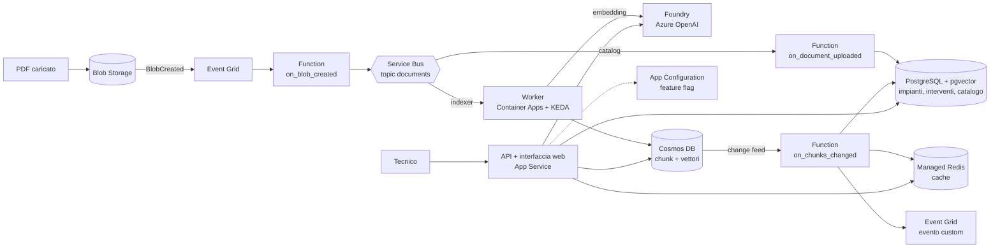

# RegDoc

Assistente per **tecnici manutentori**: il tecnico sceglie l'impianto su cui sta lavorando, descrive il problema
e riceve una risposta pratica che combina **i manuali del produttore** con **l'esperienza dal campo**, cioè
gli interventi già fatti su impianti dello stesso modello. Ogni affermazione cita la sua fonte: documento e
pagina del manuale, oppure codice e data dell'intervento.

Il primo dominio sono le **stufe a pellet**; un nuovo dominio (caldaie, climatizzatori…) si aggiunge con la
configurazione e i documenti, non con il codice.

> Progetto costruito come caso reale per la certificazione Microsoft **AI-200** (*Developing AI Cloud Solutions
> on Azure*): ogni servizio Azure ha un ruolo funzionale nel prodotto. La mappa tra servizi e skill d'esame è in
> [docs/study/ai200-skills.md](docs/study/ai200-skills.md).

## Cosa fa

- **Domande in linguaggio naturale** su un impianto preciso (matricola): la risposta usa il manuale del suo
  modello, lo storico dei suoi interventi e i guasti simili risolti su altri impianti uguali.
- **Catalogo dei documenti**: per ogni impianto il tecnico vede quali manuali esistono e se sono già
  interrogabili; chi gestisce la documentazione vede i caricamenti rimasti bloccati.
- **Indicizzazione automatica**: basta caricare un PDF nello storage, nel percorso
  `documents/{dominio}/{produttore}/{modello}/{tipo}/{file}.pdf`. Ricaricare un file lo reindicizza senza duplicati.
- **Cache delle risposte**: la stessa domanda (o una molto simile) ha risposta immediata; le risposte si
  invalidano da sole quando un manuale del dominio cambia.
- **Feature flag a runtime**: interventi nelle risposte e cache semantica si attivano senza nuovo deploy.

## Architettura



| Componente | Servizio | Ruolo |
|---|---|---|
| Ingestion | Blob Storage, Event Grid, Azure Functions (Flex Consumption) | Ogni PDF caricato diventa un messaggio sul topic, con i metadati ricavati dal percorso |
| Smistamento | Service Bus (topic + 2 subscription) | Indicizzazione e catalogo ricevono ognuno la propria copia; duplicate detection e dead-letter |
| Indicizzazione | Container Apps con scaling KEDA sulla coda, Foundry | PDF → chunk → embedding; zero repliche quando non c'è lavoro |
| Manuali | Cosmos DB for NoSQL (serverless) | Chunk con vector index; partition key gerarchica dominio → documento |
| Dati dal campo | PostgreSQL Flexible Server + pgvector | Clienti, impianti, interventi e catalogo; ricerca di guasti simili con filtri relazionali |
| Reazione alle modifiche | Change feed di Cosmos → Function | Catalogo aggiornato, cache invalidata, evento `RegDoc.Document.Indexed` per altri sistemi |
| Risposte | App Service (container), Foundry (`gpt-4.1-mini`) | API e interfaccia web, RAG con citazioni |
| Cache | Azure Managed Redis (RediSearch) | Cache esatta e semantica con indice vettoriale |
| Configurazione e osservabilità | App Configuration, Application Insights (OpenTelemetry) | Feature flag con refresh, tracce distribuite |

Le scelte e le alternative scartate sono nel [decision log](docs/decision-log.md); i problemi incontrati e
come sono stati risolti nel [troubleshooting log](docs/troubleshooting-log.md).

## Sicurezza

- **Nessun segreto**: ogni servizio usa l'autenticazione Entra ID con managed identity. Chiavi, SAS e
  password sono **disattivate** su Storage, Service Bus, Event Grid, Cosmos DB, Foundry, Redis, App
  Configuration, Application Insights e PostgreSQL.
- **Minimo privilegio**: ogni identità ha solo i ruoli che le servono, sull'ambito più stretto (un container,
  una subscription, una tabella). L'API legge e basta; la Function scrive solo il catalogo.
- **Repo pubblico**: nessun ID, nome di tenant, IP o email nei file; i valori personali arrivano come
  parametri al deploy da un file locale non tracciato.

## Installazione

Prerequisiti: una sottoscrizione Azure, [Azure CLI](https://learn.microsoft.com/cli/azure/install-azure-cli)
con Bicep, [Azure Functions Core Tools](https://learn.microsoft.com/azure/azure-functions/functions-run-local) 4,
Python 3.12, PowerShell 7.

```powershell
# 1. ambiente Python di sviluppo
py -3.12 -m venv .venv
.venv\Scripts\pip install -r requirements-dev.txt

# 2. variabili: copia il modello e compila i valori (resta fuori da git)
Copy-Item scripts\env.example.ps1 scripts\env.ps1
. .\scripts\env.ps1

# 3. crea tutto da zero: infrastruttura, immagini, Function, dati di esempio (30-40 minuti)
.\scripts\deploy\up.ps1

# 4. verifica: health, impianti, una domanda e la stessa domanda dalla cache
.\scripts\deploy\smoke-test.ps1
```

Il manuale di prova va messo in `samples/` prima di `up.ps1` (i PDF non sono nel repo per motivi di copyright).

### Costi

Le risorse a costo fisso sono App Service (B1), PostgreSQL (B1ms), Service Bus (Standard) e Managed Redis
(Balanced B0); il resto si paga a consumo (Cosmos serverless, Foundry, Functions, Container Apps a zero
repliche). Per azzerare i costi tra una sessione e l'altra:

```powershell
.\scripts\deploy\down.ps1     # cancella il resource group; up.ps1 ricrea tutto
```

## Sviluppo

```powershell
.venv\Scripts\python.exe -m pytest tests          # test, senza risorse Azure
```

| Cartella | Contenuto |
|---|---|
| `src/ingestion` | Function App: `on_blob_created`, `on_document_uploaded`, `on_chunks_changed` |
| `src/worker` | Indicizzatore su Container Apps |
| `src/api` | API FastAPI e interfaccia web |
| `src/fielddata` | Accesso a PostgreSQL: impianti, interventi, catalogo, ricerca vettoriale |
| `src/shared` | Codice comune: modelli, embedding, configurazione, telemetria |
| `infra` | `main.bicep`, moduli, schema PostgreSQL |
| `scripts/deploy` | `up.ps1`, `down.ps1`, `smoke-test.ps1` |
| `scripts/db` | Schema, permessi delle identità, import dei dati di esempio, riallineamento del catalogo |
| `scripts/tools` | Diagnosi e misure: query SQL, peek di Service Bus, ricerche vettoriali, benchmark di indici e connessioni |

## Prima di darlo a un'azienda

- **Login**: oggi l'interfaccia è aperta a chi conosce l'URL. Va attivata l'autenticazione di App Service
  (Easy Auth) con Entra ID, limitata agli utenti dell'azienda.
- **Rete**: accesso privato (VNet integration, private endpoint) al posto dell'accesso pubblico con firewall.
- **Dati dal campo**: sostituire lo script di import con la sincronizzazione dal gestionale (CRM/ERP).

## Sviluppi possibili

- **Notifiche** ai tecnici quando arriva un nuovo manuale per un modello che seguono (terzo consumer del topic).
- **Controllo qualità dei PDF**: segnalare i documenti scansionati senza testo; OCR con Document Intelligence.
- **Registrazione degli interventi dall'app**, così l'esperienza dal campo cresce con l'uso.

## Licenza

Vedi [LICENSE](LICENSE).
